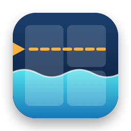

# 🌊 Tidemark — top features

| | Feature | What it does |
|:-:|---|---|
| 🔔 | **Quiet growth tracking** | Tidemark checks your drive once a day while the Mac is idle. It sends a notification only when a folder grows unusually fast. |
| 📁 | **Real folder sizes** | Every folder shows the total size of everything inside it, including all subfolders. |
| 📈 | **What changed** | The Changes tab lists folders that are new, have passed 1 GB, or grew by at least 1 GB since an earlier scan. |
| 🟦 | **Four views** | See your files as a treemap, a details list, a breakdown by file type, or a list of the largest files. |
| ⚡ | **Fast checks** | Background checks look only at folders that changed, so they take seconds instead of minutes. |
| 🧹 | **Clean up in place** | Move files and folders to the Trash, copy their paths, or right-click a folder in Finder and choose Open in Tidemark. |
